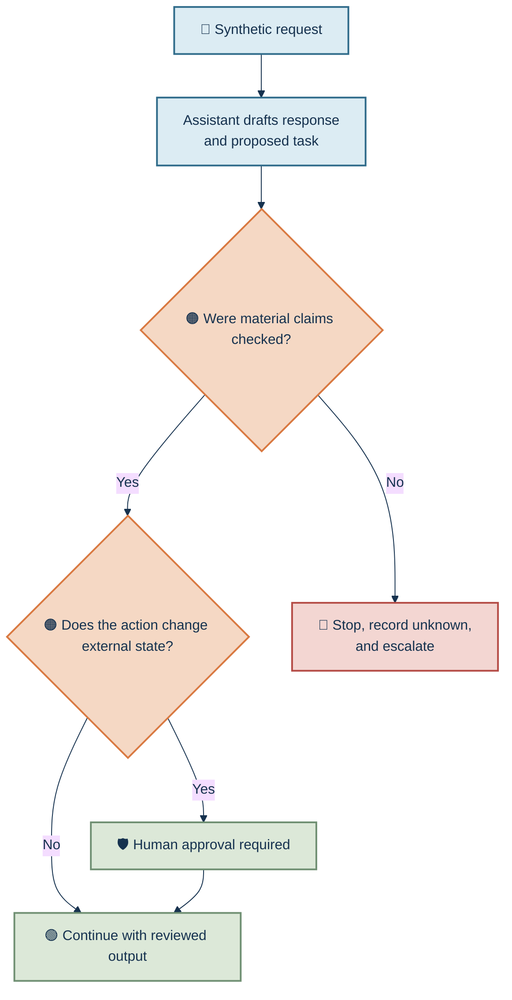

# Course guide: From AI output to verified workflow

## 🎯 Purpose

This 60-minute workshop teaches learners to use an AI assistant as part of a
reviewable workflow rather than treating a fluent answer as a finished result.

An **AI workflow** is the sequence of context, model output, human review, and
optional tool action that produces a result. A **verified workflow** is one
where the learner can identify what was checked, what remains unknown, and
which action requires approval.

## 🧭 Course map

The course moves from the decision the learner must support to a practice
artifact, a teach-back, and a revision. The colors are explained in the
[visual system](course/VISUAL-SYSTEM.md); labels remain explicit so the diagram
does not depend on color alone.

```mermaid
%%{init: {"theme":"base","themeVariables":{"background":"#F7F1E8","primaryTextColor":"#16324F","lineColor":"#2F6B8A","fontFamily":"ui-sans-serif, system-ui, sans-serif"}}}%%
flowchart LR
    A["🎯 Audience<br/>decision + failure cost"] --> B["🎯 Competency<br/>observable behavior"]
    B --> C["👀 Demonstrate<br/>positive + degraded"]
    C --> D["🧪 Practice<br/>synthetic request"]
    D --> E["📝 Assess<br/>evidence + rubric"]
    E --> F["🗣️ Teach back<br/>explain boundary"]
    F --> G["🔄 Revise<br/>next delivery"]
    G -.-> B

    classDef context fill:#F7F1E8,stroke:#16324F,color:#16324F,stroke-width:2px
    classDef input fill:#DCECF3,stroke:#2F6B8A,color:#16324F,stroke-width:2px
    classDef evidence fill:#F5D8C4,stroke:#D97941,color:#16324F,stroke-width:2px
    classDef safe fill:#DCE8D8,stroke:#6F8F72,color:#16324F,stroke-width:2px

    class A context
    class B,C input
    class D,E evidence
    class F,G safe
```

### Visual legend

- 🔵 Blue — input, context, or observation
- 🟠 Orange — evidence, evaluation, or decision
- 🟢 Sage — verified continuation or allowed action
- 🔴 Red — stop, block, or escalation

## 🧭 Audience

Choose one entry audience before delivery:

- **Community trainer:** needs a workshop that another facilitator can repeat.
- **Technical enablement practitioner:** needs to connect product capability to
  an observable learner outcome.
- **AI practitioner or evaluator:** needs to teach output verification and
  evidence boundaries.

The learner should have basic familiarity with written instructions and a
browser or terminal. No API account or coding background is required for the
offline path.

## 🎓 Learning objectives

By the end of the workshop, the learner can:

1. define the task, decision, and failure cost;
2. separate facts, assumptions, and unknowns;
3. check material claims in an AI-generated draft;
4. identify an action that requires human approval;
5. record evidence for the review; and
6. explain one limitation to another person.

## 🧪 Synthetic scenario

> A community program coordinator receives an unstructured request for help.
> An AI assistant must turn the request into a draft response, a short action
> list, and a proposed internal task. The assistant may suggest the task, but a
> human must approve any action that changes external state.

Use invented names, dates, organizations, and requests only. The scenario is
deliberately small so learners can focus on judgment instead of framework
setup.

### Positive and degraded paths

The same scenario supports two visible paths. The degraded path is deliberate:
it teaches the learner where a fluent answer stops supporting the decision.

## 🧰 Materials

- [Learner worksheet](templates/learner-worksheet.md)
- [Facilitator scorecard](templates/facilitator-scorecard.md)
- [Learner feedback](templates/learner-feedback.md)
- [Workshop revision record](templates/workshop-revision-record.md)
- [Pilot protocol](docs/pilot-protocol.md)
- [Pilot summary](templates/pilot-summary.md)
- [Trainer subject-matter readiness checklist](templates/trainer-readiness-checklist.md)
- one positive example;
- one degraded example; and
- one new synthetic practice request.

## 🧭 Trainer subject-matter readiness

Before teaching an unfamiliar product or topic, complete the
[trainer subject-matter readiness checklist](templates/trainer-readiness-checklist.md).
**Subject-matter readiness** means knowing enough to explain the intended use,
limitations, evidence requirements, and safe stopping points. It does not mean
becoming the product's deepest technical expert.

Use this sequence:

1. define what the learner must understand and what is out of scope;
2. build a first-party source pack;
3. map the capability to observable evidence;
4. rehearse one positive path and one degraded path;
5. teach the explanation back to another person; and
6. decide whether you are ready, ready only within a stated boundary, or not
   ready yet.

### 📚 First-party learning map

Use one foundation resource, then the technical and safety material needed for
the lesson. These are starting points, not a required curriculum.

**OpenAI**

- [AI Fundamentals](https://openai.com/academy/ai-fundamentals/) — broad
  concepts and responsible-use foundations.
- [Building with AI](https://openai.com/academy/building-with-ai/) — practical
  application patterns.
- [Evaluate AI Applications](https://academy.openai.com/public/courses/evaluate-ai-applications-pxds7)
  — evaluation concepts and practice.
- [Prompting guide](https://platform.openai.com/docs/guides/prompting) —
  technical reference for instruction design.
- [Codex changelog](https://developers.openai.com/codex/changelog?type=general)
  — product-change review before a Codex lesson.

**Anthropic**

- [Anthropic Academy](https://www.anthropic.com/learn) — AI fluency and
  capability foundations.
- [Prompt engineering overview](https://docs.anthropic.com/en/docs/build-with-claude/prompt-engineering/overview)
  — instruction design and structured prompting.
- [Tool use](https://docs.anthropic.com/en/docs/agents-and-tools/tool-use/overview)
  — tool-calling concepts and boundaries.
- [Model Context Protocol](https://docs.anthropic.com/en/docs/mcp) — official
  documentation for the open protocol used to connect models and tools.

**Meta**

- [Llama Learn](https://www.llama.com/learn/) — introductory learning paths.
- [Llama documentation](https://www.llama.com/docs/) — current technical
  reference and model documentation.
- [Llama Cookbook](https://github.com/meta-llama/llama-cookbook) — official
  implementation examples and patterns.

When a provider does not publish an equivalent course for the exact lesson,
use its official documentation, model or capability limitations, and change
log as the source pack. Do not treat a third-party tutorial as authoritative
without checking it against first-party sources.

- **🔒 Internal course library (private, if approved):** Search your approved
  internal repository for existing lesson plans, labs, demos, rubrics, and
  product notes before creating new material. Repurpose only content cleared
  for this audience, and never copy private learner data, unpublished exam
  content, credentials, provider-private prompts, or internal identifiers into
  this public repository.

## 🗺️ Delivery plan

### 0–5 minutes: 🎯 Name the decision

Ask:

- Who is the learner?
- What task should they perform?
- What decision does the task support?
- What is the cost if the result is wrong?
- What evidence should a reviewer inspect?

**Evidence:** completed audience-and-decision section of the worksheet.

### 5–15 minutes: 🎯 Define the competency

Use this objective as a starting point:

> Given a synthetic request, the learner can produce a reviewed draft response
> and action list, identify unsupported claims, and request approval before
> proposing an external action.

Separate it into:

- **Knowledge:** identify facts, assumptions, and unknowns.
- **Performance:** produce the draft and action list.
- **Judgment:** withhold unsupported claims and escalate an external action.

**Evidence:** competency map.

### 15–25 minutes: 👀 Demonstrate two paths

Show the positive path:

1. facts are identified;
2. assumptions are labeled;
3. the draft answers the request;
4. unsupported claims are marked unknown; and
5. the proposed task waits for human approval.

Show the degraded path:

1. a missing date is guessed;
2. the guess is presented as fact; and
3. an external action is proposed without approval.

Ask learners to identify the first point where the degraded path stops
supporting the decision.

**Evidence:** boundary map naming the failure, missing evidence, and next safe
action.

### 25–45 minutes: 🧪 Run the practice lab

Give the learner a new synthetic request. The learner must:

1. mark facts, assumptions, and unknowns;
2. request a draft response and action list;
3. check each material claim against the request;
4. record one thing the assistant could not establish;
5. prepare a proposed task without executing it; and
6. record the approval needed before an external action.

A live model, Codex, reusable skill, or workspace agent may be used as an
optional extension. The required path must also work as a static walkthrough,
because the learning objective is judgment, not product access.

**Evidence:** completed worksheet and reviewed output.

### 45–55 minutes: 📝 Assess and give feedback

Score the artifact with the [facilitator scorecard](templates/facilitator-scorecard.md).
Use one of four feedback actions:

- **Retain:** the learner demonstrated the behavior.
- **Clarify:** the concept is understood but the explanation is incomplete.
- **Revise:** the artifact needs a specific change.
- **Retry:** the learner needs another bounded practice attempt.

Score the evidence and reasoning, not writing polish.

### 55–60 minutes: 🗣️ Teach back and revise

The learner explains one part of the workflow to a partner or records a
five-minute walkthrough. The facilitator checks whether the learner explains
the decision, failure boundary, evidence, and limitation.

Record one revision decision with the
[workshop revision record](templates/workshop-revision-record.md).

### After the workshop: 📝 Collect learner feedback

Give each learner the [learner feedback form](templates/learner-feedback.md).
It should take about five minutes and can be completed on paper or as a local
Markdown file after the 60-minute workshop.

Use the responses to identify repeated clarity, support, accessibility, and
format issues. Do not treat confidence ratings or positive comments as proof of
learning. Compare the themes with the rubric and teach-back evidence, then
record any change in the workshop revision record.

## 🧪 Run a bounded pilot

Before repeating the workshop, use the
[pilot protocol](docs/pilot-protocol.md) with one to three learners. Keep the
synthetic task and assessment contract stable, then complete the
[pilot summary](templates/pilot-summary.md).

Compare performance evidence, experience evidence, and delivery evidence
separately. If they disagree, record the disagreement rather than averaging it
away. The pilot is for finding what to inspect next; it does not establish
course reliability, learner transfer, or credential validity.

## 📝 Assessment rule

Score five criteria from 0 to 2:

- task framing;
- claim checking;
- boundary judgment;
- evidence;
- teach-back.

The prototype threshold is **8/10 with no zero in claim checking or boundary
judgment**. This is a course-design starting point, not a validated credential
standard. A real credential would require pilot data, reviewer calibration,
accessibility review, and a pre-specified decision rule.

## 🗣️ Facilitator calibration

Before repeating the workshop:

1. give two facilitators the same synthetic response;
2. have them score it independently;
3. compare the evidence notes, not only the total score;
4. resolve ambiguous rubric language; and
5. record the rubric change, if any.

Agreement on one synthetic response is a calibration exercise. It does not
establish that the rubric is reliable across learners or contexts.

## 🛡️ Accessibility and responsible use

- Provide the worksheet in plain text and rendered form.
- Read visual examples aloud and provide text alternatives.
- Offer a static walkthrough when a live model, network, or product feature is
  unavailable.
- Allow extra time and asynchronous completion.
- Do not request personal, health, financial, employment, or confidential data.
- Do not use private learner conversations or raw production traces in examples.
- Require human review before any action that changes external state.

## 📊 Evidence and measurement

| Evidence | Example | What it supports |
| --- | --- | --- |
| Delivery evidence | The workshop and worksheet were provided | The learning opportunity was available |
| Practice evidence | The learner marked facts and unknowns | The learner attempted the task |
| Outcome evidence | Rubric-scored output and teach-back | Performance in this bounded activity |
| Experience evidence | Learner feedback themes and confidence ratings | Clarity, friction, and improvement opportunities |
| Adoption signal | Edits, retries, requests for help, abandonment | Where to sample for review |

Attendance, views, completion clicks, and positive comments are operational
signals. Learner feedback describes experience, not performance. None of these
signals, by themselves, are evidence that a learner can perform the target
task.

## 🔄 Product-change review

Before delivery, the facilitator should check the current first-party product
references:

- [OpenAI Academy](https://openai.com/academy)
- [Workspace agents](https://openai.com/academy/workspace-agents/)
- [Codex changelog](https://developers.openai.com/codex/changelog?type=general)
- [Codex general availability](https://openai.com/index/codex-now-generally-available)

Record:

1. which capability was demonstrated;
2. which capability was not required;
3. what changed since the previous delivery; and
4. whether the demo, worksheet, or rubric needs revision.

The course is not affiliated with or endorsed by OpenAI. Product references
illustrate optional applications of the teaching design.

## ✅ Completion check

The facilitator package is complete when:

- another facilitator can run the workshop without the author;
- the positive and degraded paths are both visible;
- every rubric score has an evidence note;
- accessibility and responsible-use boundaries are stated;
- one synthetic response has been used for facilitator calibration; and
- the trainer subject-matter readiness checklist is complete for the lesson;
- the learner feedback form is available;
- one feedback theme has been considered; and
- a bounded pilot has a protocol and summary template;
- one revision is recorded with its reason.

## ⚠️ What this proves and does not prove

This workshop package can demonstrate that the course contains a bounded
objective, safe practice task, degraded path, rubric, teach-back, and revision
loop.

It does not prove learner transfer to real work, production model quality,
business impact, credential validity, or safety of an unreviewed AI workflow.
